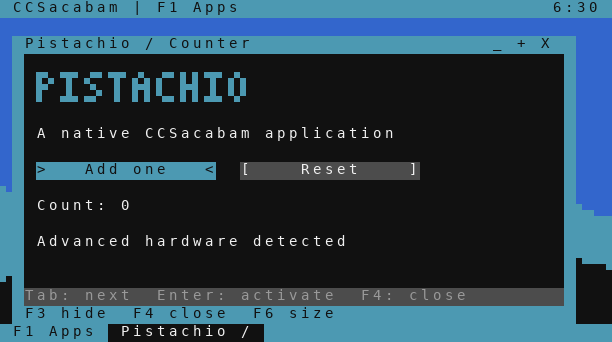
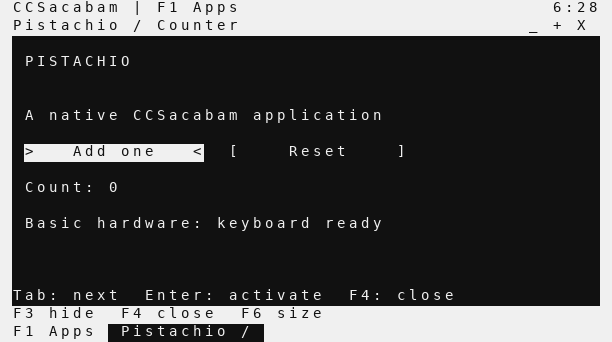

# CCSacabam

A windowed workspace for ComputerCraft, with optional drive encryption, ordinary Lua terminals, and native visual apps written in **Pistachio Script**.

**Basic computers** get monochrome windows and complete keyboard navigation. **Advanced computers** get color, mouse controls, and an optional render mode with 2×3 subpixel graphics and a small custom banner font. Render mode uses normal terminal APIs, so it does not require CraftOS-PC graphics extensions.

| Advanced render mode | Basic monochrome mode |
| --- | --- |
|  |  |

Previews are rendered from emulator terminal snapshots; their normal text uses a host monospace font.

## Try it in CraftOS-PC

From this folder on your real computer:

```sh
./run.sh
```

Use `./run.sh --basic` for a separate basic-computer save. These launchers use `.craftos/advanced` and `.craftos/basic` here, leaving your usual CraftOS-PC save alone. On the first run, choose a display mode and encryption setting, install, and create a passphrase of at least 12 characters. Later runs boot the installed copy. Set `CCSACABAM_DATA_DIR` to choose another save directory.

**Encryption starts off.** Fine to leave off on a private computer. On a shared server, try encryption: it is CCSacabam's main security feature for protecting saved files. Turn it on during installation or later in Settings. Login still works with encryption off, but the files are readable outside the OS. Existing drives keep their setting during upgrades.

## Install in ComputerCraft

The complete offline installer is [`dist/ccsacabam-installer.lua`](dist/ccsacabam-installer.lua). Copy that one file onto the computer and run it. No Pastebin or additional downloads are needed.

Once this checkout is published to the repository's `main` branch, ComputerCraft's `wget` command can download it:

```text
wget https://raw.githubusercontent.com/ThePearlKing/CCBaspis/main/dist/ccsacabam-installer.lua install.lua
install
/ccsacabam/boot.lua
```

HTTP must be enabled on the Minecraft server for `wget`. The installer stages and checks the package, preserves unrelated files, and backs up existing startup programs under `/ccsacabam-backups`. It installs to `/ccsacabam` and enables startup on reboot. Re-run the installer to upgrade while preserving the personal drive. `/ccsacabam/uninstall.lua` restores the previous startup and keeps your data.

The target is modern **CC: Tweaked**, with `bit32`, `window`, `term.blit`, and `cc.require`, on a terminal of at least 20×10. Validation uses CraftOS-PC 2.8.3 / CC:Tweaked 1.112.0. Older ComputerCraft forks and arbitrary third-party programs are not universally verified.

## Use the desktop

| Key | Action |
| --- | --- |
| F1 | Open launcher; type to search |
| F2 | Switch windows, including minimized windows |
| F3 / F4 | Minimize / close |
| F5 | Cancel a dialog or operation; leave login |
| F6 | Maximize or restore |
| F7 / F8 | Move / resize with arrows; Enter accepts, F5 cancels |
| F9 / F10 | Lock / exit to CraftOS |
| Tab / Shift+Tab / Enter | Select and activate native app controls |

Advanced computers also support clicking, scrolling, dragging title bars, and resizing from the bottom-right corner. Save your work before locking or exiting; unsaved app buffers are discarded.

Included apps: Files with Trash, Editor with undo and search, Terminal, Sketch with a rotating 3D demo, Pistachio, your original Chat+, Callisto, Jupiter, Settings, Tasks, Devices, and Guide. Chat+ is copied into `Programs` and runs as a normal Lua program.

## Programs and the personal drive

Run ordinary `.lua` programs in Terminal or open them in Files. `fs`, `io`, settings, `require`, and the normal CraftOS shell work with the personal drive. Root paths such as `/Documents/note.txt` and the `/ccsacabam/home/Documents/note.txt` alias refer to the same file. Existing physical files are available read-only under `/host` for importing. `/rom` and installed system files are also read-only inside the session.

This changes where programs save data, not Lua syntax. Programs needing write access to ROM/system files, a particular physical disk, another OS's startup environment, or a larger screen may need adaptation. Multitasking is cooperative, as in ComputerCraft: a program that never yields can block the machine.

With encryption on, the personal drive stores **encrypted filenames and contents**, including settings, Trash, and logs. Leaving CCSacabam exposes ciphertext in `/ccsacabam/vault/data.scv`, not a plaintext home directory. With encryption off, this same file contains readable data. Public OS code and files that existed before installation remain readable. The drive currently has a **192 KiB serialized capacity** and rewrites its image on each committed change.

Read [security and recovery](docs/SECURITY.md) before relying on the vault. It protects stored files, not a running computer from malicious Lua, modified boot code, or an administrator inspecting memory. There is no password reset. The cryptography is unaudited.

## The programming family

* [**Pistachio Script**](docs/PISTACHIO.md): visual app language with controls, handlers, expressions, loops, functions, timers, hardware detection, and `seal` / `unseal` encryption. Examples are installed in `Programs`.
* [**Peanut**](docs/PEANUT.md): JSON-compatible data, with comments, unquoted keys, and trailing commas. `require("peanut")`.
* [**Ganymede**](docs/GANYMEDE.md): native controls for ordinary Lua. `require("ganymede")`. Io handles I/O; its fellow Jupiter moon gets the UI job.
* [**Europa**](docs/EUROPA.md): modem networking, domain lookup, and computer-ID addresses. `require("europa")`.
* **Callisto**: browser for Europa sites.
* **Jupiter**: hosts the sites, naturally.
* **Cashew**: HTML-like markup with embedded Pistachio events. A site's entry page is `index.cashew`.

The welcome site is installed at `/Sites/welcome`. Open Jupiter, choose a domain such as `workshop.cc`, and start hosting with a modem attached. On another computer, open Callisto and visit `europa://workshop.cc/` or `europa://123/`, using the host's computer ID. You can preview `file:///Sites/welcome/index.cashew` without a modem. Europa traffic is public and unauthenticated; vault encryption protects local storage only.

## Development

```sh
python3 tools/build.py
python3 tools/test.py advanced basic network fresh fresh-basic pocket
```

The build creates a deterministic installer and SHA-256 checksum. Tests use disposable emulator saves in `/tmp`; they do not touch your ordinary computers. The test runner needs Python's `cryptography` package for independent verification. See [testing](docs/TESTING.md) for coverage and limits.
